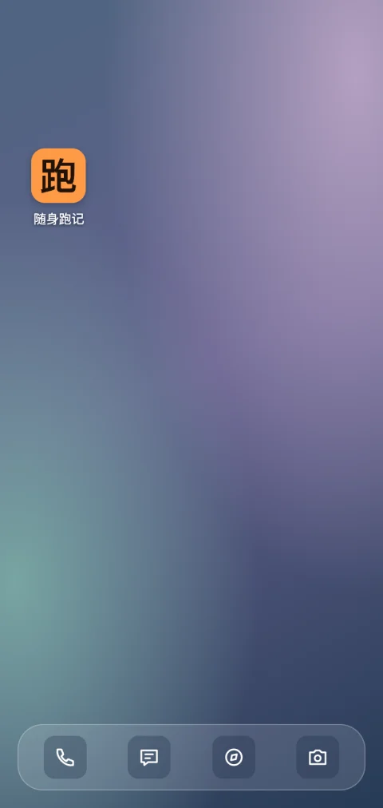
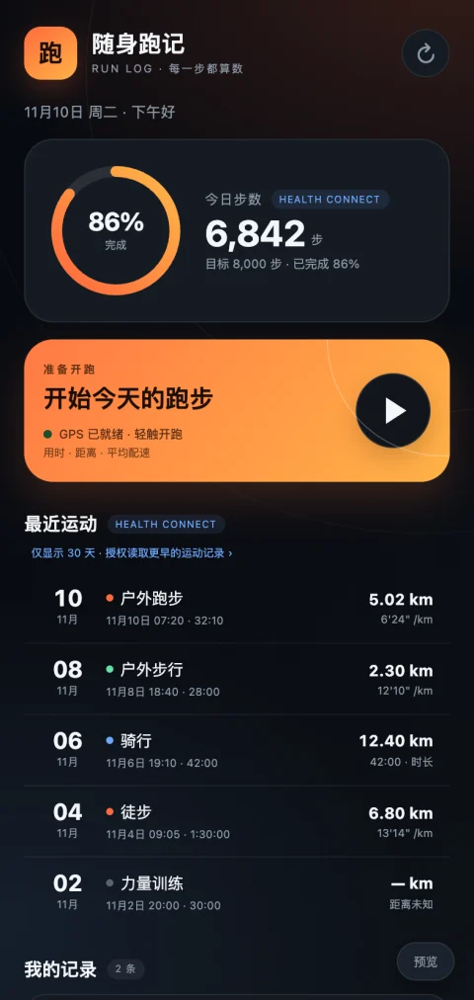
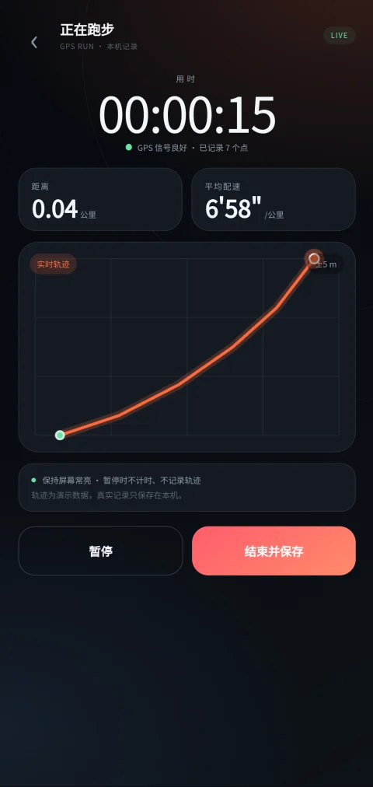

# dsh-go-android-app

`dsh-go-android-app` 是一个 DSH Go 插件。直接告诉 Agent 你想做什么，先预览效果，再打包成可独立安装的 Android 应用。

## 开始使用

先在 DSH Go 完成本机引擎初始化，并配置可用的模型。

把下面这条命令发给本机聊天里的 Agent，请它安装插件。也可以在 DSH Go 的本机终端运行。弹出审批时，核对命令后选「仅允许一次」。

```sh
dsh plugin --profile web add https://registry.npmjs.org/dsh-go-android-app/-/dsh-go-android-app-0.1.1.tgz
```

安装成功后，在 DSH Go 的「引擎」页重启本机引擎。

新开一个本机聊天，选择工作区，直接描述想做的应用。

> 我想做一个叫「随身跑记」的跑步计时器。能开始、暂停和结束计时，并记住每次跑了多久。

1. 在同一台手机上点聊天里的「打开手机桌面预览」，再点 **随身跑记** 的图标查看效果。
2. 回到聊天提出修改意见。预览过期时，可以说「刷新预览」。
3. 满意后回复「确认打包」。Agent 会检查构建环境，首次构建按提示确认下载所需工具和 Android SDK 许可。
4. 打开 Agent 返回的 APK 文件卡或链接，按 Android 安装器提示安装，再从手机桌面打开应用。

之后想修改应用，回到原聊天继续说需求，查看新预览，确认后重新打包安装。

## 看看实际效果

下面是「随身跑记」案例的桌面预览、应用预览和安装后的跑步画面。

| 手机桌面预览 | 点图标进入应用预览 | 安装后记录跑步 |
| --- | --- | --- |
|  |  |  |

预览中的健康数据是示例数据。安装后的画面来自 Android 14 模拟器，轨迹使用模拟定位。案例中的 GPS 和 Health Connect 是单独接入的能力，尚未进入插件模板。

需要手动配置、源码安装或了解实现时，可查看[开发者与进阶文档](https://github.com/keyboard3/dsh-go-android-app/blob/main/docs/advanced.md)。
